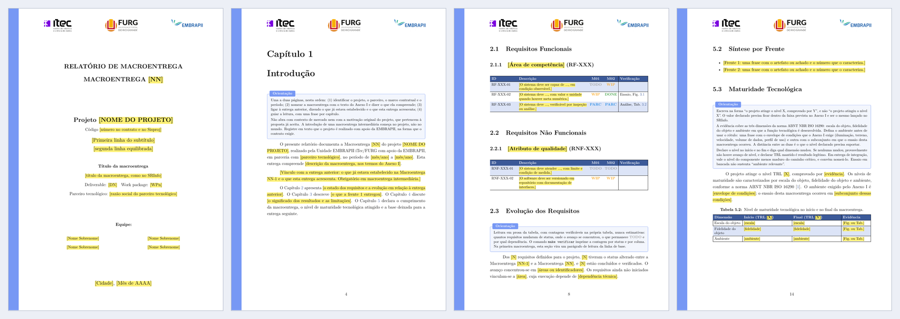

# Template de relatório de macroentrega (EMBRAPII)

Modelo em LaTeX para escrever o relatório de macroentrega de projetos EMBRAPII. Traz a estrutura do relatório, a tabela de requisitos com status, as caixas de transcrição do contrato e uma verificação automática antes da entrega. Nasceu na Unidade EMBRAPII iTec/FURG e usa o cabeçalho com as logomarcas da Unidade, da FURG e da EMBRAPII.



PDFs de exemplo, compilados com os marcadores ainda no lugar:
[macroentrega intermediária](docs/exemplo-macroentrega.pdf) e
[relatório final](docs/exemplo-relatorio-final.pdf).

## Começando

```bash
git clone https://github.com/tioguerra/template-relatorio-macroentrega-embrapii.git
cd template-relatorio-macroentrega-embrapii
make
```

Precisa de TeX Live completo (pdfLaTeX, BibTeX e latexmk). No Overleaf, abra o projeto e compile `main.tex` com pdfLaTeX.

1. Abra o Anexo I do contrato e copie a descrição literal da macroentrega. Ela é o critério de aceite.
2. Preencha `\dadosrelatorio{...}` no início de `main.tex`.
3. Substitua cada marcador amarelo `\ph{...}` pelo conteúdo definitivo. As caixas azuis de orientação dizem o que cada seção precisa conter.
4. Rode `make verificar`, corrija o que ele apontar e leia o PDF página a página.
5. Rode `make entrega` para gerar o PDF final.

## Dois modos de compilação

| Modo | Como | O que muda |
|---|---|---|
| `rascunho` (padrão) | `make` | Marcadores `\ph{}` em amarelo e caixas de orientação visíveis. |
| `entrega` | `make entrega` | As orientações somem e qualquer `\ph{}` restante vira erro de compilação. O PDF sai em `main-entrega.pdf`. |

Com `entrega`, o documento só compila quando não resta marcador pendente, o que impede que um "Informar local" chegue ao PDF assinado.

## Estrutura

```
main.tex                  macroentrega intermediária, inclusive a primeira
main-final.tex            relatório final
macroentrega.cls          classe: página, cabeçalho, tabelas e comandos
capitulos/                capítulos da macroentrega intermediária
capitulos_final/          capítulos do relatório final
referencias.bib           referências (BibTeX)
LOGO/  IMAGES/            logomarcas e figuras
scripts/verificar.py      conferência antes da entrega
Makefile
```

Um arquivo por capítulo, numerado de dez em dez para deixar espaço: para acrescentar uma frente, copie `30_frente_1.tex` para `40_frente_2.tex` e inclua em `main.tex`. Ao remover um capítulo, não renumere os demais.

## Comandos do modelo

| Comando | Para quê |
|---|---|
| `\dadosrelatorio{chave=valor,...}` | Dados da capa e da página de assinaturas. Valor com vírgula vai entre chaves. |
| `\setlogos{a.png,b.png,...}` | Logomarcas do cabeçalho, de uma a quatro, espaçadas por igual. |
| `\capa`, `\paginaassinaturas` | Capa e página de assinaturas, montadas com os dados acima. |
| `\ph{texto}` | Marcador pendente. Contado em rascunho, erro em entrega. |
| `\orientacao{texto}` | Caixa de orientação ao autor. Some em entrega. |
| `\begin{transcricao}{fonte}` | Bloco de transcrição literal do contrato, que não se edita. |
| `\begin{tabelarequisitos}{M01,M02}` e `\req{ID}{descrição}{\wip & \done}{verificação}` | Tabela de requisitos com uma coluna de status por macroentrega, cabeçalho repetido entre páginas e coluna de verificação. |
| `\todo` `\wip` `\parc` `\done` | Status de requisito: não iniciado, em andamento, parcial, concluído e verificado. |
| `\estilotabela` e `\cab{texto}` | Corpo, espaçamento e cabeçalho colorido das tabelas comuns. |
| `\figuraph[altura]{texto}` | Moldura para figura ainda não produzida. |
| `\referencias{arquivo}` | Seção de referências no sumário. |
| `\begin{resumo}` e `\begin{siglas}` | Resumo e lista de siglas. |

A capa aceita `tipo=intermediaria` ou `tipo=final`. Campos opcionais: `codigo`, `subtitulo`, `deliverable`, `wp`, `parceiro`, `periodo` (final), `confidencialidade` e `codigorelatorio`.

## Verificação

```bash
make verificar     # compila e confere main.tex
make entrega       # modo entrega + verificação bloqueante
```

`scripts/verificar.py` lê o log e o PDF já gerados e aponta:

- erro de compilação, referência ou citação não resolvida, figura ausente e rótulo repetido;
- texto que estoura a mancha e conteúdo que estoura a página;
- marcador pendente, texto de preenchimento (`XXX`, `AAAA`) e dados de exemplo na capa;
- resumo fora da faixa de 150 a 300 palavras;
- requisito com status incompatível com o número de colunas, identificador repetido e linha `PARC` ou `DONE` sem método e evidência na coluna de verificação;
- a contagem de requisitos por status e por coluna, para a leitura da tabela.

Com `--paginas`, renderiza as páginas em `_verificacao/` para a leitura visual. O script não substitui essa leitura: figura ilegível, legenda trocada e título partido só aparecem olhando as páginas.

## Primeira macroentrega e relatório final

Na primeira macroentrega, use uma única coluna de status, `{M01}`, em `tabelarequisitos`, troque a seção de evolução dos requisitos por um parágrafo sobre a linha de base e inclua um capítulo técnico com a prova de conceito que sustenta o TRL declarado.

`main-final.tex` traz a capa do relatório final, a equipe por função, listas de figuras, tabelas e siglas, a metodologia geral, a tabela consolidada de requisitos, um capítulo por pacote de trabalho (com o material de transferência de tecnologia), a conclusão com limitações e trabalhos futuros e os anexos A a F. Compile com `make final`.

## Outra Unidade

Troque as imagens em `LOGO/`, a lista em `\setlogos{}` e a chave `unidade` em `\dadosrelatorio{}`.

As logomarcas do iTec, da FURG e da EMBRAPII pertencem às respectivas instituições e entram no modelo para identificar a Unidade e o apoio da EMBRAPII. Use-as conforme os manuais de identidade visual de cada uma.

## Referências do modelo

- ABNT NBR 10719:2015, Informação e documentação, Relatório técnico e/ou científico, Apresentação.
- ABNT NBR ISO 16290:2015, Sistemas espaciais, Definição dos níveis de maturidade da tecnologia (TRL) e de seus critérios de avaliação.

## Licença

[MIT](LICENSE). A licença cobre o código do modelo, não as logomarcas.
